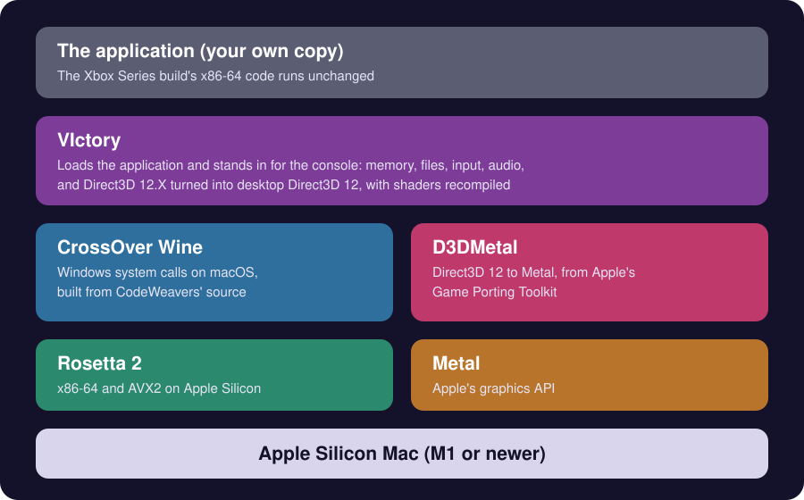

<h1 align="center">VIctory for macOS</h1>

<p align="center">
A translation layer that runs Xbox Series (GDK) x86-64 applications on Apple Silicon Macs.<br>
It loads the application's code unchanged, stands in for the console's system libraries, and translates its Direct3D 12.X calls and console GPU shaders to desktop Direct3D 12, which Apple's D3DMetal runs on Metal.
</p>

<p align="center">


</p>

This is a fork of [pragyaangaur/VIctory-macOS](https://github.com/pragyaangaur/VIctory-macOS), which brings [VIctory](https://github.com/Marvisak/VIctory) to the Mac. It carries further work on correctness and speed under Wine, Rosetta 2 and D3DMetal.

> [!IMPORTANT]
> **Experimental.** The layer is a research project and is not ready for everyday use. No application files, keys or proprietary code are included here, and none ever will be. You supply your own legally obtained files.

## What it does

| Part | What it does |
| --- | --- |
| Loader | Maps the application's executable and DLLs into one process and runs its code unchanged |
| Console runtime | Stands in for the console's system libraries: memory, files, saves, input, audio and network rules |
| GPU layer | Translates the console's Direct3D 12.X into desktop Direct3D 12, keeping CPU and GPU views of shared memory consistent |
| Shader recompiler | Recompiles console GPU (RDNA 2) shader code to DXIL, checked against the hardware's results, including 64-lane programs on 32-lane Apple GPUs |
| Frame record and replay | Records one frame of host GPU work and replays it without the application, for timing and experiments (`docs/replay.md` on the `tools/frame-replay` branch) |

## How it works

<p align="center"></p>

Xbox Series applications are x86-64 code, like Windows programs. VIctory loads that code and supplies everything the console would have supplied. On a Mac, VIctory itself runs as a Windows program:

- **Rosetta 2** runs the x86-64 code, including AVX2.
- **CrossOver Wine** provides Windows. The setup builds it from the source CodeWeavers publishes, because Apple's D3DMetal only works with that branch of Wine.
- **D3DMetal**, from Apple's Game Porting Toolkit, turns Direct3D 12 into Metal.

## Set it up

You need an Apple Silicon Mac (M1 or newer) on macOS 15 or newer, [Homebrew](https://brew.sh), and about 15 GB of free space.

1. **Get the code** (this repository is private; clone it with an account that has access).

   ```bash
   git clone https://github.com/64bitMango/VIctory-macOS.git
   cd VIctory-macOS
   ```

2. **Download Apple's Game Porting Toolkit.** Apple gives D3DMetal only to signed-in developers. Open the [Apple developer downloads](https://developer.apple.com/download/all/?q=game%20porting%20toolkit), sign in with any Apple account, and download the newest Game Porting Toolkit `.dmg` (4.0 beta 3 or newer). Leave it in your Downloads folder unopened.

3. **Run the setup.**

   ```bash
   ./setup.sh
   ```

   It installs what it needs with Homebrew, builds the x86_64 libraries and CrossOver Wine, adds D3DMetal from the toolkit, and builds VIctory. The first run takes about an hour, mostly building Wine. If it stops, fix what it says and run it again; finished steps are skipped.

When it says **Setup finished**, check that VIctory starts:

```bash
tools/macos/victory.sh config
```

## Running an application

Copy `victory.example.toml` to `victory.toml`, set the application folder (`game_dir`) to your own copy of the files, outside this repository, and start it:

```bash
tools/macos/victory.sh run --execute <the application's executable>
```

## Running the tests

Natively on the Mac:

```bash
cargo test --workspace
```

As Windows programs under Wine with D3DMetal, including the GPU tests:

```bash
WINE="$HOME/Library/Caches/victory-macos/target/wine-cx/bin/wine" WINEDLLOVERRIDES="d3d12,d3d12core,dxgi=b" tools/macos/test-wine.sh --workspace --no-fail-fast
```

## Switches

Behaviour changes are behind `VICTORY_...` environment variables, each documented in a comment where it is read. Diagnostics builds (`VICTORY_DIAGNOSTICS=1 tools/macos/victory.sh ...`) add per-frame statistics and debugging aids, among them:

| Variable | What it does |
| --- | --- |
| `VICTORY_LOG=<target>=debug,...` | Debug and trace output |
| `VICTORY_STACKS=<seconds>,...` | Prints every thread's stack at those times after start |
| `VICTORY_GPU_TIMING=1` | Submits and times each GPU list on its own |
| `VICTORY_CAPTURE=<folder>` | Saves presented frames as half-size PNGs |
| `VICTORY_DUMP_TARGETS=1` | With `VICTORY_CAPTURE`, saves every render target of listed frames |
| `VICTORY_SKIP_PIPELINES=<hash>,...` | Omits draws and dispatches whose pipeline contains a listed shader hash |
| `VICTORY_UNWAITED_CHECK=1` | Checks at run time that copies of shared memory stay consistent and stops at the first violation (`docs/unwaited.md`) |
| `VICTORY_D3D12_DEBUG=1` | Host debug layer |

## Where things are

| Path | What it holds |
| --- | --- |
| `setup.sh` | The one-step setup |
| `tools/macos/` | The Wine build, the library build, the launcher and the test runner |
| `crates/` | The runtime: loader, console runtime, GPU layer, shader recompiler and formats |
| `docs/architecture.md` | How VIctory is put together |
| `docs/macos.md` | The Mac port: problems found and how each was fixed |

## Acknowledgement

Built on [VIctory](https://github.com/Marvisak/VIctory) by Marvisak and [VIctory-macOS](https://github.com/pragyaangaur/VIctory-macOS) by Pragyaan Gaur and its contributors, whose history is kept in this repository. Thanks also to CodeWeavers for publishing CrossOver's source, to the Wine project, and to Apple for the Game Porting Toolkit.

## Legal

This project is not affiliated with or endorsed by Microsoft or Apple. Xbox is a trademark of Microsoft. This repository contains no application files, keys or proprietary code. D3DMetal is not included; each user downloads it from Apple under Apple's terms.

This fork modifies the original work; changes are recorded in the commit history. The code is licensed under the [GNU General Public License v3.0](LICENSE).
